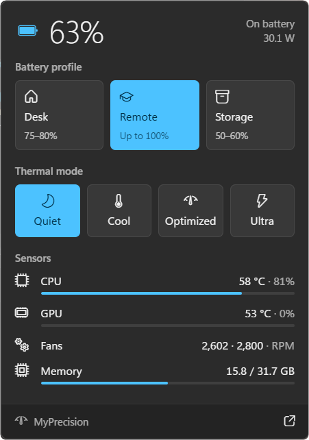
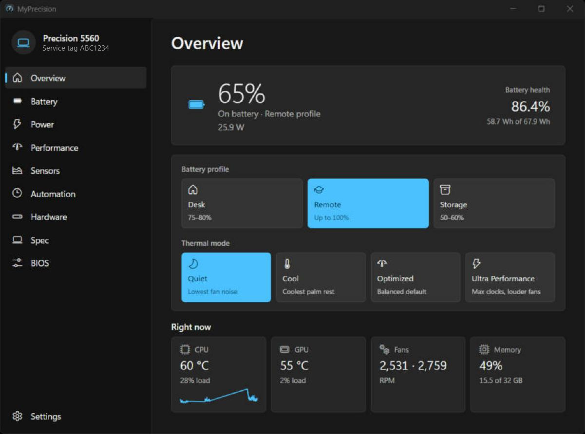
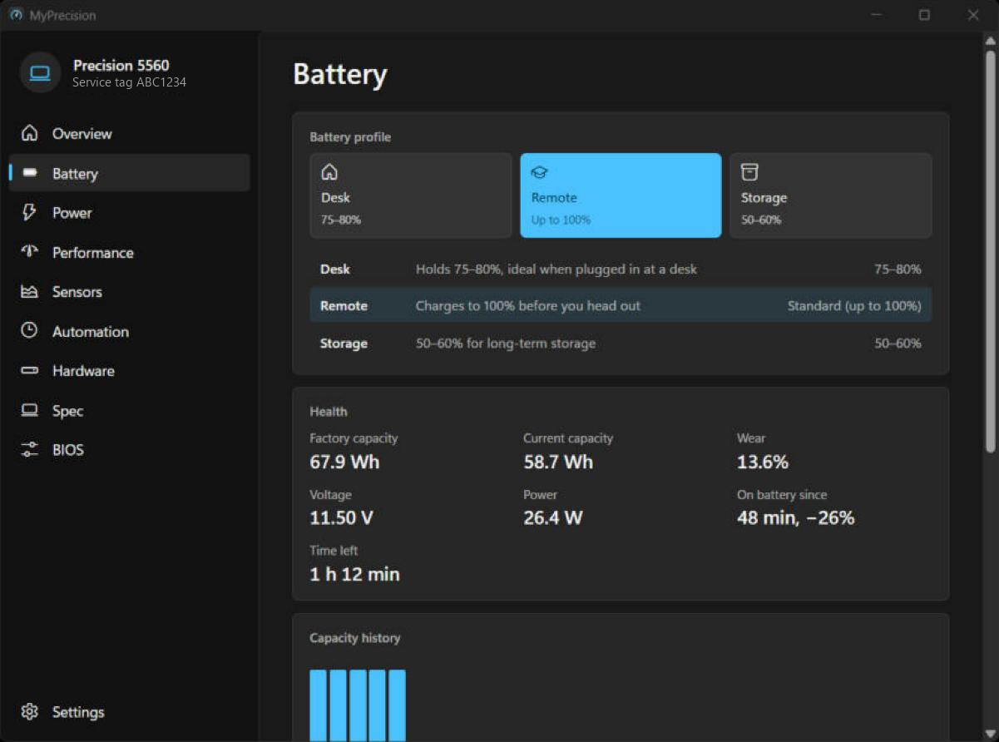
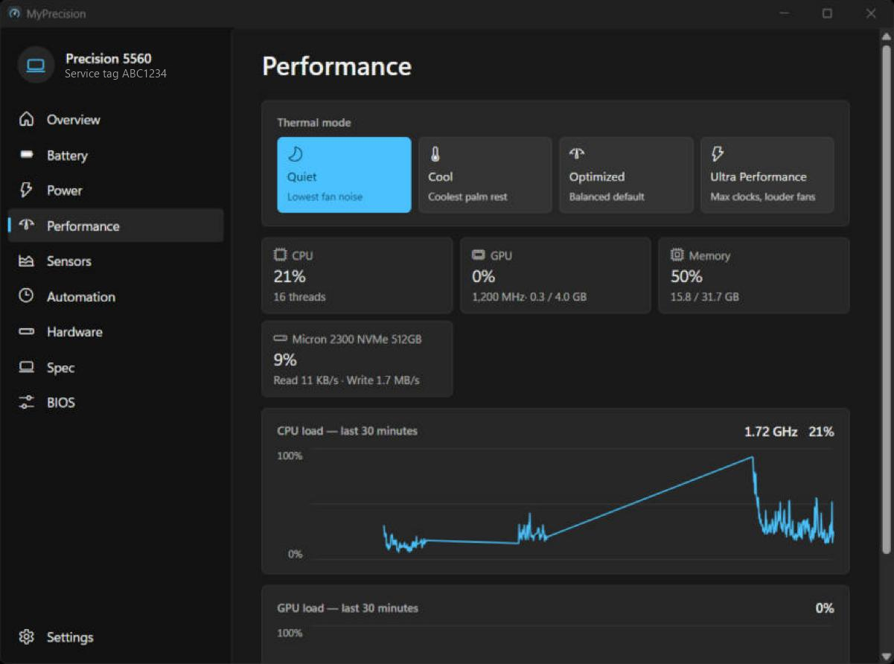

<div align="center">


# MyStation

**The Dell control center that stays out of your way.**

Battery charge limits, thermal modes, a full sensor monitor and hardware insight,
in a tray app built for Windows 11. No bloat, no telemetry.

[](https://github.com/al3ksh/MyStation/releases/latest)
[](https://github.com/al3ksh/MyStation/releases)
[](https://github.com/al3ksh/MyStation/actions/workflows/ci.yml)
[](LICENSE)


[](#-credits)

[**Download**](https://github.com/al3ksh/MyStation/releases/latest) ·
[Features](#-features) ·
[Requirements](#-requirements) ·
[Build](#-build-from-source) ·
[Changelog](CHANGELOG.md)

<br>



</div>

---

## ✨ Why MyStation

Dell Optimizer and SupportAssist do the job, but they come with services,
pop-ups and telemetry. MyStation does the everyday part — charge limits,
thermal modes, health and power stats — in a 2 MB installer.

<table>
<tr>
<td width="33%" valign="top">

### ⚡ Fast
Rust underneath, opens from the tray at once. Reading GPU stats never
wakes a sleeping NVIDIA card, so it doesn't cost you battery.

</td>
<td width="33%" valign="top">

### 🪟 Native look
Acrylic flyout, Mica window, Segoe Fluent icons. It looks like part of
Windows 11, not a web page.

</td>
<td width="33%" valign="top">

### 🔒 Private
No accounts, no telemetry, no network calls except checking GitHub for
signed updates.

</td>
</tr>
</table>

The app takes the name of the laptop it runs on: **MyPrecision** on a
Precision, **MyXPS** on an XPS, **MyLatitude** on a Latitude, and
**MyStation** on anything else.

## 🧭 Features

### Tray flyout
Click the tray icon for charge, power draw and temperatures. Switch the
battery profile or thermal mode in one click. The tray icon shows the charge
level live.

| Battery profile | Charge range | For |
|-----------------|--------------|-----|
| 🖥️ **Desk**     | 75–80%       | Plugged in most of the day |
| 🎒 **Remote**   | up to 100%   | Before you head out |
| 📦 **Storage**  | 50–60%       | Laptop sitting unused for a while |

**Thermal modes:** Optimized · Cool · Quiet · Ultra Performance

### Full window

<p align="center">
  
  
  
</p>

| Page | What you get |
|------|--------------|
| 🏠 **Overview** | What the machine is doing right now. |
| 🔋 **Battery** | Health, factory vs. current capacity, wear history, charge and power charts. Time left on battery, time to the charge limit, and how long you've been unplugged. |
| 📈 **Performance** | Load of every part — CPU, GPU, memory, each drive — with the actual CPU clock and when the firmware holds it back. |
| 🌡️ **Sensors** | Every temperature and fan, plus a **sensor monitor**: one table with every reading and its min and max, hot values in red. |
| 🔌 **Power** | Integrated vs. NVIDIA graphics, a per-app graphics choice (Auto / Integrated / NVIDIA), battery use by app, sleep drain. |
| 🧩 **Hardware** | Drive health and wear forecast, startup apps and boot time, USB devices and their speed, displays and what they could run at. |
| 📋 **Spec** | The processor, memory, graphics, storage, screen, Wi-Fi, Thunderbolt, TPM — read from the laptop itself. |
| 🤖 **Automation** | Routines: when you join a Wi-Fi network, plug in or unplug, connect a display or Bluetooth device, drop below a battery level, stay plugged in for days, or at a set time — switch the thermal mode, battery profile and Windows power mode. |
| 🛠️ **BIOS** | Read and change supported BIOS options. |
| ⚙️ **Settings** | Autostart and updates. |

**Signed updates.** New versions come from GitHub Releases, are verified
against the app's signing key and install in the background.

## 📋 Requirements

- **Windows 11** (Windows 10 may work but is untested).
- A **Dell laptop** supported by Dell Command | Configure: Precision, Latitude
  and most XPS models.
- [**Dell Command | Configure**](https://www.dell.com/support/kbdoc/en-us/000178000/dell-command-configure)
  — required for battery profiles, thermal modes and BIOS settings. The app
  links to it when it's missing.
- [Dell Command | Monitor](https://www.dell.com/support/kbdoc/en-us/000177080/dell-command-monitor)
  *(optional)* — fan speeds and extra temperature sensors.
- An NVIDIA driver *(optional)* — GPU stats.

> [!NOTE]
> MyStation runs with administrator rights, because changing BIOS charge and
> thermal settings needs them. Autostart registers a scheduled task, so there's
> no UAC prompt on every boot.

## 📥 Install

1. Download `MyStation_x.y.z_x64-setup.exe` from
   [**Releases**](https://github.com/al3ksh/MyStation/releases/latest).
2. Run it. That's it — later versions show up in **Settings → Updates**.

> [!TIP]
> Up to 0.4.0 the app was called MyPrecision. Updating from it installs
> MyStation alongside; on first start MyStation moves the sign-in task over and
> quietly removes the old install. Settings and history are kept.

## 🛠️ Build from source

You need [Node.js](https://nodejs.org) 20+, [Rust](https://rustup.rs) (stable,
edition 2024) and the
[Tauri prerequisites for Windows](https://tauri.app/start/prerequisites/).

```bash
npm install
npm run tauri dev
```

<details>
<summary><b>Installer, tests and project layout</b></summary>

<br>

Build an installer:

```bash
npm run tauri build
```

Run the tests:

```bash
npm test
npm run check
cargo test --workspace --lib
cargo clippy --workspace --lib --all-targets -- -D warnings
```

```
crates/core/   platform-independent logic: battery, profiles, BIOS, sensors, history
src-tauri/     the Tauri app: commands, tray, poller, automation, Windows APIs
src/           Svelte UI: flyout, full window pages, components, tests
scripts/       version bump and release (signed installer + updater manifest)
```

</details>

<details>
<summary><b>Releasing</b></summary>

<br>

1. `npm run bump -- x.y.z` sets the version in `package.json`,
   `package-lock.json`, `src-tauri/tauri.conf.json`, both `Cargo.toml` files
   and `Cargo.lock`, and turns the `Unreleased` section of
   [CHANGELOG.md](CHANGELOG.md) into the dated `x.y.z` section.
2. Commit the result to master and push it.
3. `npm run release` builds the signed installer, tags the commit and
   publishes a GitHub Release with the `latest.json` manifest the updater
   reads. Its notes come from the changelog.

The script refuses to run when the tree is dirty, when master is not level
with origin, or when the version has no changelog section. Add `--dry-run` to
build without publishing. The signing key stays on the maintainer's machine
and is never committed.

</details>

## 🤝 Credits

Built by [Aleks Szotek](https://github.com/al3ksh), co-authored with
**Claude Opus 5.5** by [Anthropic](https://www.anthropic.com).
Developed and tested on a Dell Precision 5560 (Intel + NVIDIA T1200).

## ⚖️ Disclaimer

MyStation is an independent project. It is not affiliated with, endorsed by
or supported by Dell Technologies. Dell, Precision, Latitude, XPS, Dell
Command | Configure and Dell Command | Monitor are trademarks of Dell Inc. The
app changes BIOS settings through Dell's own tools, and you use it at your own
risk.

<div align="center">

<br>

[MIT](LICENSE) © 2026 Aleks Szotek

</div>
